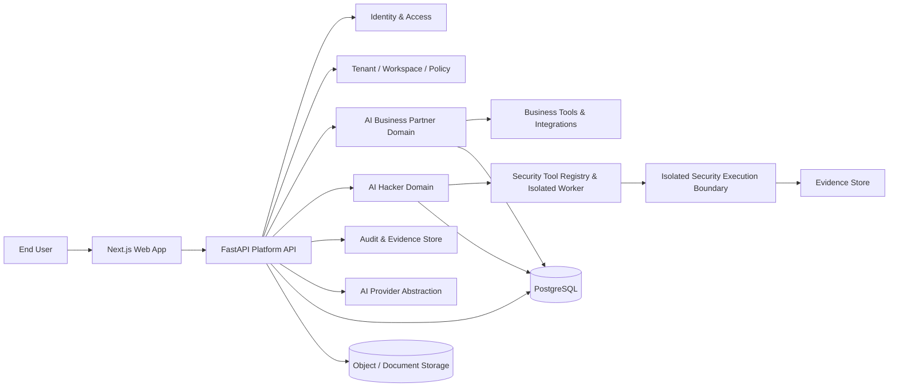
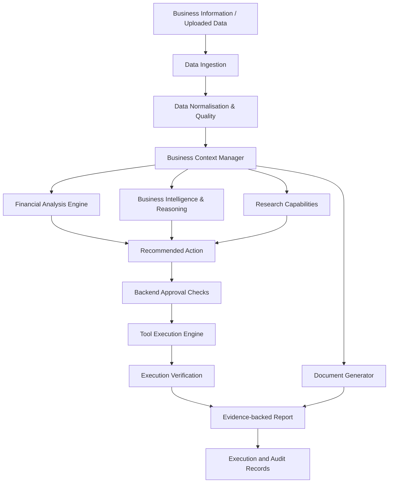
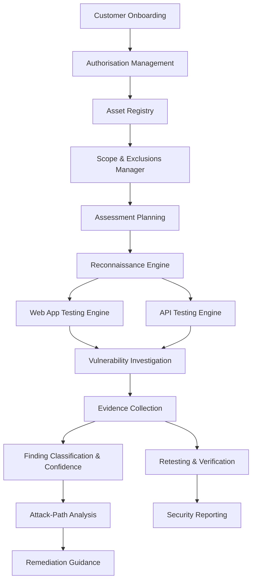
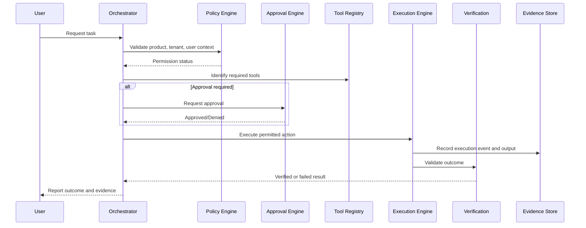
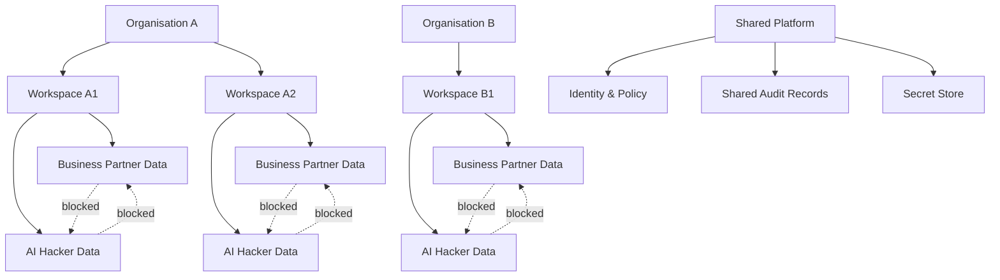
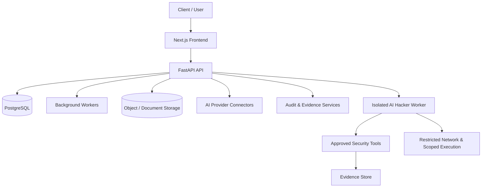

# Architecture diagrams

This document contains the core Mermaid diagrams for the proposed architecture. Each diagram reflects the shared platform model, the two specialist product domains, and the execution safety constraints described in the architecture package.

## 1. Overall platform architecture

### Explanation

The platform API sits between the web app and the core shared services. The business and security domains each have their own execution logic and permission model, while the shared platform provides identity, policy, storage, AI abstraction, and audit support.

## 2. Business Partner component architecture

### Explanation

The Business Partner keeps business context and financial logic separate from the LLM reasoning layer. Business calculations are deterministic and auditable, while the reasoning layer interprets results and recommends action.

## 3. AI Hacker component architecture

### Explanation

The Hacker architecture keeps assessment planning and evidence validation tightly coupled to authorised scope and approval policies. Findings are not treated as valid until they are validated and tied to evidence.

## 4. Agent execution lifecycle

### Explanation

The lifecycle is shared across both products. Approval and policy checks happen before execution, and verification occurs after execution. This pattern prevents the LLM from being treated as the decision boundary.

## 5. Business Partner data flow

```mermaid
flowchart LR
    User[User / Business Owner] --> Ingest[Data Ingestion]
    Ingest --> Validate[Validation & Normalisation]
    Validate --> Context[Business Context Store]
    Context --> Finance[Financial Analysis]
    Finance --> Insight[Business Intelligence]
    Insight --> Action[Recommended Action]
    Action --> Approve[Approval Policy]
    Approve --> Tool[Approved Business Tool]
    Tool --> Verify[Execution Verification]
    Verify --> Report[Business Outcome Report]
    Report --> Audit[Audit + Evidence Records]
```

### Explanation

Business Partner data flows from raw inputs into normalised business context, then into analysis and recommendation. The flow keeps source data, assumptions, and calculations separate so that financial explanations remain grounded in evidence.

## 6. AI Hacker assessment flow

```mermaid
flowchart LR
    Customer[Customer + Assets] --> Onboard[Onboarding]
    Onboard --> Scope[Scope & Exclusions]
    Scope --> Plan[Assessment Plan]
    Plan --> Recon[Permitted Reconnaissance]
    Recon --> Test[Web / API Testing]
    Test --> Findings[Finding Validation]
    Findings --> Evidence[Evidence Collection]
    Evidence --> Risk[Risk & Impact Analysis]
    Risk --> Report[Security Report]
    Report --> Remediate[Remediation Guidance]
    Remediate --> Retest[Retesting & Verification]
```

### Explanation

The Hacker assessment flow is bounded by scope, permissions, and evidence. Nothing moves directly from test execution to final report without validation and evidence capture.

## 7. Tenant and product data boundaries

### Explanation

Each organisation is isolated at the tenant and workspace layers. Product data is separated by domain. Shared platform services remain common, but they do not grant shared authority across the specialist product domains.

## 8. Initial deployment topology

### Explanation

The deployment model keeps the application stack small and realistic. The main runtime is the shared platform, while the security execution worker remains a separate runtime boundary with limited network and tool access.
