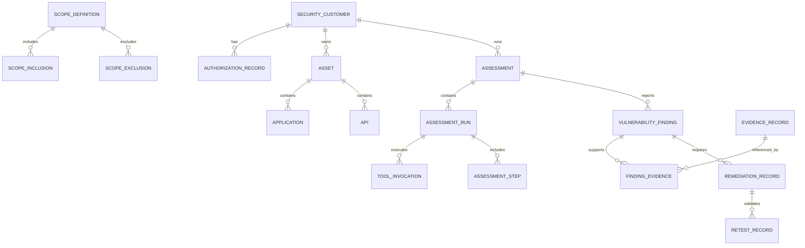

# AI Hacker data model

## 1. Purpose

This document defines the logical data model for the AI Hacker product. It supports the authorised security assessment MVP and records the customer, asset, scope, assessment, finding, evidence, remediation, and retest lifecycle.

The model is intentionally separate from the Business Partner domain and must retain strict execution and evidence boundaries.

## 2. Core domains

### Customer and authorisation

#### Security customer

Purpose:
- represent the organisation or customer under assessment.

Key attributes:
- security_customer_id
- organisation_id
- name
- contact_user_id
- status
- onboarding_date

Relationships:
- one-to-many with assets and authorisation records,
- linked to the tenant organisation.

#### Registered asset

Purpose:
- represent a discovered or authorised asset under assessment.

Key attributes:
- asset_id
- security_customer_id
- organisation_id
- asset_type
- asset_name
- domain
- ip_ref
- status
- created_at

#### Domain

Purpose:
- represent an in-scope domain or host group.

Key attributes:
- domain_id
- security_customer_id
- domain_name
- status
- owner_asset_id

#### Application

Purpose:
- represent a web application under review.

Key attributes:
- application_id
- security_customer_id
- asset_id
- app_name
- environment
- url_base
- status

#### API

Purpose:
- represent an API or API group under assessment.

Key attributes:
- api_id
- security_customer_id
- asset_id
- api_name
- base_url
- auth_mode
- status

#### Authorisation record

Purpose:
- capture the explicit permission to assess a customer and scope.

Key attributes:
- authorisation_id
- security_customer_id
- organisation_id
- authorised_by
- authorised_at
- valid_from
- valid_to
- status
- authorisation_type

#### Scope definition

Purpose:
- represent the entire approved testing scope.

Key attributes:
- scope_definition_id
- security_customer_id
- scope_name
- description
- authorised_by
- created_at

#### Scope inclusion

Purpose:
- capture approved in-scope targets.

Key attributes:
- scope_inclusion_id
- scope_definition_id
- asset_id
- domain_id
- application_id
- api_id
- inclusion_type
- status

#### Scope exclusion

Purpose:
- capture explicitly excluded items.

Key attributes:
- scope_exclusion_id
- scope_definition_id
- asset_id
- domain_name
- exclusion_reason
- status

#### Test window

Purpose:
- define authorised time windows for testing.

Key attributes:
- test_window_id
- security_customer_id
- scope_definition_id
- start_at
- end_at
- timezone
- status

#### Test restrictions

Purpose:
- capture restrictions such as blocked endpoints, accounts, or techniques.

Key attributes:
- test_restriction_id
- scope_definition_id
- restriction_type
- restriction_value
- reason

#### Test account reference

Purpose:
- reference authorised test accounts or credentials used for assessment.

Key attributes:
- test_account_id
- security_customer_id
- scope_definition_id
- credential_ref
- account_role
- status

## 3. Assessment management domain

### Assessment

Purpose:
- represent a single authorised assessment engagement or cycle.

Key attributes:
- assessment_id
- security_customer_id
- organisation_id
- status
- authorisation_id
- started_at
- completed_at
- created_by

### Assessment plan

Purpose:
- define the tactical plan for a testing engagement.

Key attributes:
- assessment_plan_id
- assessment_id
- plan_version
- objective_summary
- priority
- created_at

### Assessment run

Purpose:
- represent one execution of the plan or a subset of it.

Key attributes:
- assessment_run_id
- assessment_id
- run_type
- status
- started_at
- completed_at
- environment_ref

### Assessment step

Purpose:
- track stages or actions in an assessment run.

Key attributes:
- assessment_step_id
- assessment_run_id
- step_type
- step_order
- status
- started_at
- completed_at

### Tool invocation

Purpose:
- record the actual tool invocations used in assessment execution.

Key attributes:
- tool_invocation_id
- assessment_run_id
- tool_id
- invocation_status
- started_at
- completed_at
- tool_request_ref
- tool_result_ref

### Assessment status

Purpose:
- capture overall progress and final state.

Key attributes:
- assessment_status_id
- assessment_id
- status_code
- reason
- updated_at

### Execution environment reference

Purpose:
- connect a run to the isolated execution boundary used.

Key attributes:
- execution_environment_id
- assessment_run_id
- environment_name
- network_policy_ref
- resource_profile

## 4. Security findings domain

### Vulnerability finding

Purpose:
- represent a specific security issue that has been identified and validated.

Key attributes:
- finding_id
- assessment_id
- asset_id
- application_id
- api_id
- finding_title
- description
- status
- severity
- confidence
- validation_status
- discovered_at
- created_by

### Finding classification

Purpose:
- categorise the vulnerability type or family.

Key attributes:
- finding_classification_id
- finding_id
- class_name
- classification_source

### Severity

Purpose:
- store severity rating with rationale.

Key attributes:
- severity_id
- finding_id
- severity_level
- score
- rationale_ref
- assigned_by

### Confidence

Purpose:
- record confidence that the issue is valid.

Key attributes:
- confidence_id
- finding_id
- value
- rationale_ref

### Validation status

Purpose:
- indicate whether a finding is suspected, validated, duplicate, or rejected.

Key attributes:
- validation_id
- finding_id
- status
- validated_by
- validated_at
- reason

### Affected asset

Purpose:
- map the finding to the exact target or resource affected.

Key attributes:
- affected_asset_id
- finding_id
- asset_id
- related_endpoint
- affected_component

### Reproduction evidence

Purpose:
- record evidence that supports the finding.

Key attributes:
- reproduction_evidence_id
- finding_id
- evidence_id
- reproduction_step
- result_summary

### Business impact

Purpose:
- represent the likely impact on the system or organisation.

Key attributes:
- business_impact_id
- finding_id
- impact_type
- impact_statement
- risk_level

### Remediation recommendation

Purpose:
- store fix guidance connected to the finding.

Key attributes:
- remediation_id
- finding_id
- recommendation_text
- priority
- recommended_by

## 5. Evidence and remediation domain

### Evidence record

Purpose:
- stores the proof object associated with a finding or assessment.

Key attributes:
- evidence_id
- organisation_id
- assessment_id
- finding_id
- evidence_type
- stored_ref
- captured_at
- owner_service

### Evidence file reference

Purpose:
- link an external file or artifact to a finding or assessment step.

Key attributes:
- evidence_file_id
- evidence_id
- file_ref
- mime_type
- sha256_hash
- created_at

### Evidence collection timestamp

Purpose:
- track when evidence was obtained.

Key attributes:
- evidence_timing_id
- evidence_id
- captured_at
- event_type

### Finding-to-evidence relationship

Purpose:
- allows one finding to connect to multiple evidence items.

Key attributes:
- finding_evidence_id
- finding_id
- evidence_id
- relationship_type

### Remediation record

Purpose:
- tracks a remediation task or action.

Key attributes:
- remediation_record_id
- finding_id
- owner_user_id
- status
- created_at
- closed_at

### Retest record

Purpose:
- records the post-fix validation attempt.

Key attributes:
- retest_id
- finding_id
- remediation_record_id
- started_at
- completed_at
- status

### Verification result

Purpose:
- captures the result of the retest or validation activity.

Key attributes:
- verification_result_id
- retest_id
- result_status
- evidence_id
- verified_at

### Final assessment report

Purpose:
- stores the final customer-facing report or summary.

Key attributes:
- assessment_report_id
- assessment_id
- report_ref
- generated_at
- status

## 6. Required workflow traceability

The data model must support the lifecycle:

Authorisation → Scope → Assessment → Testing → Investigation → Validation → Evidence → Reporting → Remediation → Retesting.

To do that, the model must preserve:

- what was authorised,
- what was in scope,
- what was tested,
- what was executed,
- what evidence supports a finding,
- what was validated and by whom,
- how the final report was produced.

## 7. Finding validation requirements

Not every scanner result or output becomes a finding entry. A finding should only be promoted to a confirmed vulnerability once it is associated with:

- an authorised scope,
- an affected asset,
- evidence and reproduction information,
- a validation status,
- the result of investigation or retest.

This prevents the model from treating all technical noise as a validated vulnerability.

## 8. Example relationship model

## 9. Important design rule

The AI Hacker is not an unbounded security scanner. The data model must always retain the link between:

- customer,
- authorisation,
- scope,
- test window,
- actual execution,
- evidence,
- validation status,
- final report.

Without this traceability, the model cannot demonstrate safe, authorised, and evidence-based assessment execution.
