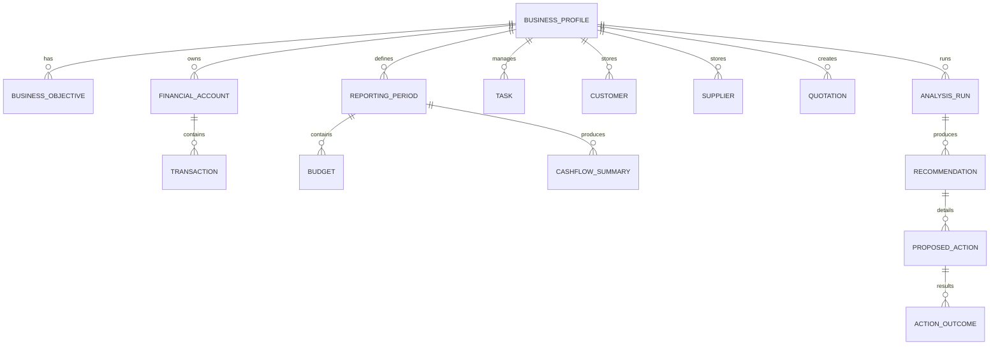

# Business Partner data model

## 1. Purpose

This model supports the approved AI Business Partner MVP for business context, financial analysis, workflow execution, and operational reporting. The data model provides a structured representation of the business, its financial information, operational tasks, and the evidence chain behind recommendations.

The model is intentionally not a full accounting system and does not replace professional bookkeeping software.

## 2. Core domains

### Business context

#### Business profile

Purpose:
- stores the core description of the organisation or business context.

Key attributes:
- business_profile_id
- organisation_id
- workspace_id
- business_name
- business_type
- business_category
- industry
- country
- region
- founder_or_owner_user_id
- created_at
- updated_at

Relationships:
- one-to-one with organisation or tenant-owned workspace concept,
- one-to-many with objectives, operating context, and financial records.

#### Business objectives

Purpose:
- describe strategic and operational goals.

Key attributes:
- objective_id
- business_profile_id
- objective_type
- description
- target_metric
- status

#### Business preferences

Purpose:
- capture operational or strategic preferences used in analysis and recommendation.

Key attributes:
- preference_id
- business_profile_id
- preference_type
- value
- source

#### Business operating context

Purpose:
- track customer model, suppliers, sales model, processes, constraints, and assumptions.

Key attributes:
- business_context_id
- business_profile_id
- context_type
- context_value
- effective_from
- effective_to

## 3. Financial information domain

### Financial account or source

Purpose:
- represent the external accounting or business finance source feeding the system.

Key attributes:
- financial_account_id
- business_profile_id
- source_type
- source_name
- status
- connection_ref
- external_account_ref

### Revenue records

Purpose:
- record sale or income entries.

Key attributes:
- revenue_record_id
- business_profile_id
- period_id
- customer_id
- amount
- currency
- revenue_date
- source
- imported_from
- is_imported_fact

### Expense records

Purpose:
- record operating cost entries.

Key attributes:
- expense_record_id
- business_profile_id
- period_id
- supplier_id
- category_id
- amount
- currency
- expense_date
- source
- is_imported_fact

### Financial category

Purpose:
- classify transactions for analysis.

Key attributes:
- category_id
- business_profile_id
- category_name
- parent_category_id
- category_type

### Transactions

Purpose:
- support a normalized ledger model for imported and user-entered financial movement.

Important attributes:
- transaction_id
- business_profile_id
- account_id
- category_id
- customer_id
- supplier_id
- transaction_date
- direction
- amount
- currency
- source_ref
- is_imported_fact
- quality_status

### Reporting periods

Purpose:
- define financial windows used for analysis.

Important attributes:
- period_id
- business_profile_id
- period_type
- start_date
- end_date
- status

### Budgets

Purpose:
- store expected values for business comparison.

Key attributes:
- budget_id
- business_profile_id
- period_id
- category_id
- target_amount
- currency
- created_at

### Actual versus budget records

Purpose:
- compare actuals to plan and highlight variance.

Key attributes:
- variance_record_id
- business_profile_id
- period_id
- category_id
- actual_amount
- budget_amount
- variance_amount
- variance_percent

### Cash-flow summaries

Purpose:
- aggregate net movement over a period.

Key attributes:
- cashflow_summary_id
- business_profile_id
- period_id
- opening_balance
- inflow_total
- outflow_total
- closing_balance
- calculated_at

### Profitability and margin calculations

Purpose:
- store derived metrics from the financial engine.

Key attributes:
- financial_metric_id
- business_profile_id
- period_id
- metric_type
- metric_name
- value
- currency
- calculation_basis_ref
- confidence_score
- calculated_at

Important rule:
- imported financial facts and calculated metrics must remain distinct.
- AI-generated interpretation or narrative should not be treated as the source of financial truth.

## 4. Business operations domain

### Tasks

Purpose:
- represent to-dos or operational workload items.

Key attributes:
- task_id
- business_profile_id
- assignee_user_id
- task_type
- title
- description
- status
- priority
- due_at
- created_at

### Task assignments

Purpose:
- capture role or user assignment to a task.

Key attributes:
- task_assignment_id
- task_id
- assignee_user_id
- assignment_type
- status

### Operational activities

Purpose:
- model recurring or custom operational events.

Key attributes:
- activity_id
- business_profile_id
- activity_type
- description
- occurred_at
- status

### Follow-up records

Purpose:
- track customer or business follow-up actions.

Key attributes:
- follow_up_id
- business_profile_id
- related_entity_type
- related_entity_id
- follow_up_type
- due_at
- status

### Sales leads

Purpose:
- hold prospective customer opportunities.

Key attributes:
- lead_id
- business_profile_id
- lead_source
- lead_status
- contact_name
- company_name
- value_estimate
- created_at

### Customer records

Purpose:
- represent customer or account records.

Key attributes:
- customer_id
- business_profile_id
- name
- segment
- status
- created_at

### Supplier records

Purpose:
- represent supplier or vendor records.

Key attributes:
- supplier_id
- business_profile_id
- name
- category
- status
- created_at

### Supplier comparisons

Purpose:
- record supplier scorecards and pricing comparison results.

Key attributes:
- supplier_comparison_id
- business_profile_id
- supplier_id
- comparison_period
- score
- pricing_summary_ref
- evaluated_at

### Quotations

Purpose:
- store customer-facing quotes or pricing proposals.

Key attributes:
- quotation_id
- business_profile_id
- customer_id
- quote_number
- status
- created_at
- valid_until
- total_amount
- currency

### Generated business documents

Purpose:
- store reports, proposals, summaries, and other generated business outputs.

Key attributes:
- document_id
- business_profile_id
- document_type
- title
- generated_by
- created_at
- document_ref

## 5. Business intelligence domain

### Business metrics

Purpose:
- store tracked KPI values used in dashboards and analysis.

Key attributes:
- metric_id
- business_profile_id
- metric_name
- metric_type
- value
- period_id
- source_ref

### Analysis runs

Purpose:
- represent a particular analysis or interpretation cycle.

Key attributes:
- analysis_run_id
- business_profile_id
- analysis_type
- started_at
- completed_at
- status
- created_by

### Identified issues

Purpose:
- capture business problems observed in the data.

Key attributes:
- issue_id
- analysis_run_id
- issue_type
- description
- severity
- evidence_ref

### Opportunities

Purpose:
- capture positive signals or actionable opportunities.

Key attributes:
- opportunity_id
- analysis_run_id
- opportunity_type
- description
- confidence_score

### Recommendations

Purpose:
- represent a proposed operational or business recommendation.

Key attributes:
- recommendation_id
- analysis_run_id
- recommendation_type
- summary
- rationale_ref
- priority
- status

### Proposed actions

Purpose:
- capture the specific action being proposed or approved.

Key attributes:
- proposed_action_id
- recommendation_id
- action_type
- target_system
- payload_ref
- approval_required

### Action outcomes

Purpose:
- track the actual result of an executed action.

Key attributes:
- action_outcome_id
- proposed_action_id
- status
- started_at
- completed_at
- outcome_summary
- verification_ref

## 6. Traceability requirements

A recommendation must be able to trace back to:

- underlying business context,
- relevant financial facts or operational data,
- the analysis run that identified the pattern,
- evidence or source references,
- any action that was proposed,
- the approval decision and execution record,
- final outcome or verification result.

This requires one or more linking tables:

- recommendation_to_evidence
- recommendation_to_metric
- recommendation_to_transaction
- action_to_execution_run
- analysis_run_to_source

## 7. Data flow support

The model supports the lifecycle:

Business context → Financial data → Analysis → Identified problem → Recommended action → Approval → Execution → Verification → Outcome.

The key link is that the recommendation and action must reference the exact facts and metrics that support them, not just a generic narrative summary.

## 8. Example relationship model

## 9. Important distinctions

The model should always separate:

- imported financial facts,
- calculated financial values,
- AI-generated explanation,
- recommended action,
- executed action result,
- verified outcome.

This prevents the model from confusing narrative output with the actual source of truth.
