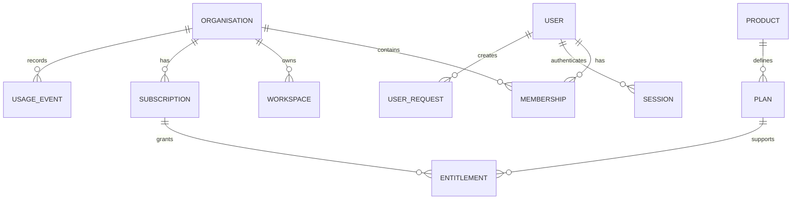
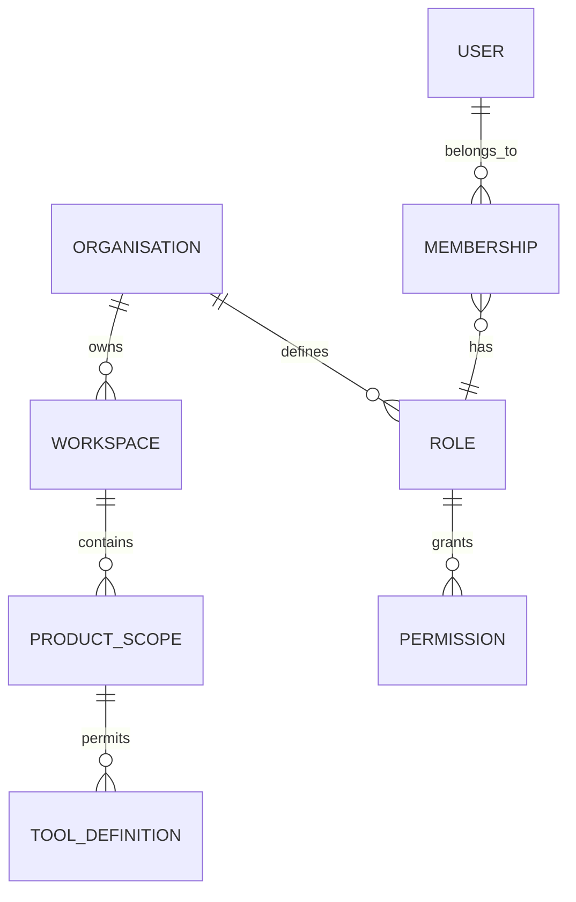
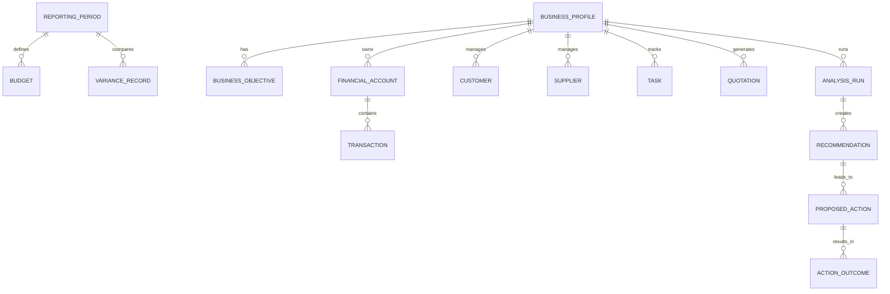
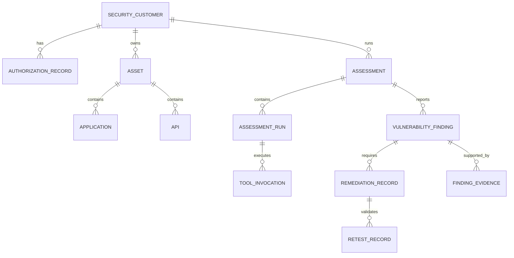
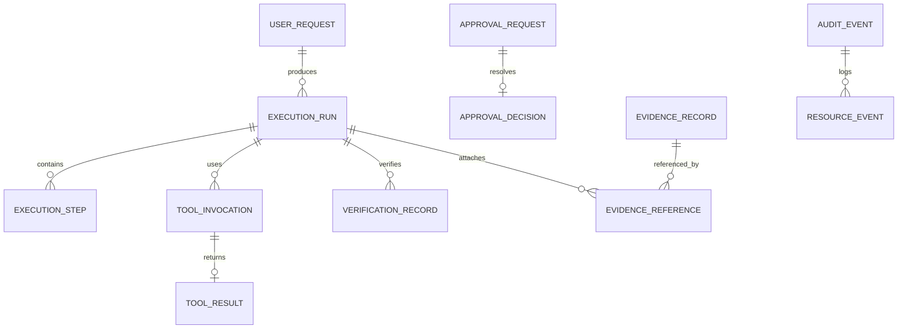
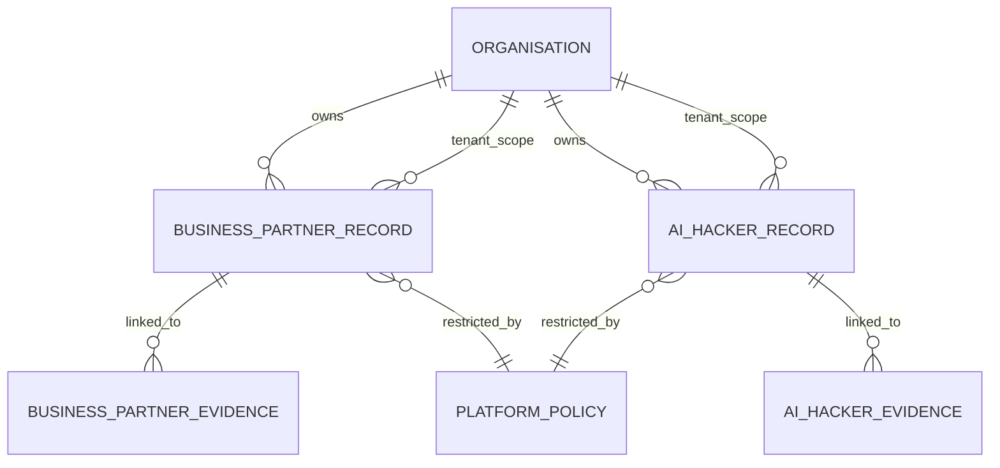

# Entity relationship diagrams

This document contains conceptual ER diagrams for the logical database model. These are design diagrams, not implemented schemas.

## 1. Shared platform and identity

### Explanation

This diagram captures the organisational and identity layer, including membership, workspaces, subscription and entitlement, and usage tracking.

## 2. Tenant and workspace relationships

### Explanation

The platform keeps user membership and workspace access separate from product capability authorisation. A user may belong to an organisation without automatically gaining every product capability.

## 3. Business Partner

### Explanation

The Business Partner model links business context, financial facts, analyses, recommendations, and final action outcomes.

## 4. AI Hacker

### Explanation

The Hacker model preserves the chain from authorisation and scope to assessment, evidence, validation, and retesting.

## 5. Agent execution, approvals and evidence

### Explanation

This diagram represents the execution and governance layer: requests, tool execution, approval gating, evidence linkage, and verification.

## 6. Product data boundaries

### Explanation

This diagram makes clear that the two product domains are separate despite sharing the same platform and infrastructure. The platform policy layer governs access and separation.
