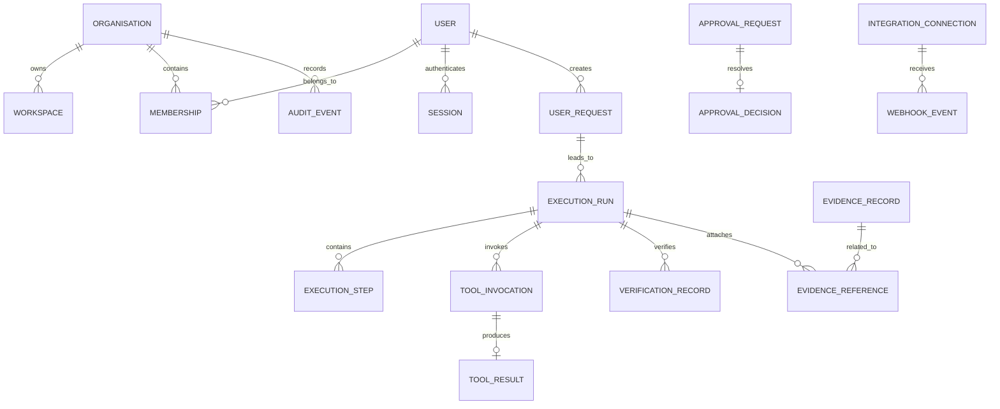

# Shared platform data model

## 1. Purpose

The shared platform owns the common operational and governance data used by both the Business Partner and AI Hacker. These tables are not product-specific and are used to manage identity, policy, execution, approvals, audit, integrations, and usage.

## 2. Identity and access domain

### Users

Purpose:
- represent platform users.

Important attributes:
- user_id
- organisation_owner_id (optional)
- email
- password_hash_ref or credential_ref
- display_name
- status
- created_at
- last_login_at
- mfa_required

Ownership:
- platform-owned.

Relationships:
- one-to-many with memberships,
- one-to-many with sessions,
- one-to-many with approvals and execution runs.

### Organisations

Purpose:
- represent the top-level tenant boundary.

Important attributes:
- organisation_id
- name
- slug
- legal_name
- status
- owner_user_id
- created_at

Relationships:
- one-to-many with workspaces,
- one-to-many with subscriptions,
- one-to-many with memberships.

### Workspaces

Purpose:
- represent logical project or operational areas inside an organisation.

Important attributes:
- workspace_id
- organisation_id
- name
- slug
- status
- created_at
- default_product_access

Relationships:
- many to one with organisation,
- linked to tenant-scoped product records.

### Memberships

Purpose:
- link users to organisations.

Important attributes:
- membership_id
- organisation_id
- user_id
- role_id
- status
- invited_by
- invited_at
- accepted_at
- revoked_at

### Roles

Purpose:
- group permissions into reusable assignments.

Important attributes:
- role_id
- organisation_id
- name
- type
- created_at

Relationships:
- many-to-many with permissions.

### Permissions

Purpose:
- represent a named capability or action.

Important attributes:
- permission_id
- code
- domain
- description
- risk_level

### Sessions or authentication references

Purpose:
- record active user sessions or tokens.

Important attributes:
- session_id
- user_id
- organisation_id
- token_ref
- issued_at
- expires_at
- revoked_at
- session_status

Relationships:
- one-to-many with user,
- stored with tenant context to prevent cross-org use.

## 3. Subscription and usage domain

### Products

Purpose:
- logical product definitions.

Important attributes:
- product_id
- code
- name
- status
- description

### Plans

Purpose:
- define subscription tiers or plans.

Important attributes:
- plan_id
- product_id
- name
- billing_model
- status

### Entitlements

Purpose:
- grant access to product capabilities or feature gate requirements.

Important attributes:
- entitlement_id
- organisation_id
- product_id
- plan_id
- feature_code
- granted_at
- expires_at
- status

### Subscriptions

Purpose:
- represent the commercial relationship with the product.

Important attributes:
- subscription_id
- organisation_id
- product_id
- plan_id
- status
- start_date
- end_date
- created_at

### Usage events

Purpose:
- record measured consumption over time.

Important attributes:
- usage_event_id
- organisation_id
- product_id
- workspace_id
- metric_name
- value
- source
- created_at

### Usage summaries

Purpose:
- aggregate usage into reporting or quota views.

Important attributes:
- usage_summary_id
- organisation_id
- product_id
- period_start
- period_end
- metric_name
- total_value
- status

## 4. Agent execution domain

### Agent sessions

Purpose:
- represent a user or system session in which an agent operates.

Important attributes:
- agent_session_id
- organisation_id
- workspace_id
- product_code
- user_id
- created_at
- status

Relationships:
- one-to-many with user requests and execution runs.

### User requests

Purpose:
- represent a concrete user objective or task input.

Important attributes:
- user_request_id
- agent_session_id
- user_id
- organisation_id
- workspace_id
- product_code
- request_text
- request_type
- created_at
- status

### Execution runs

Purpose:
- represent a single execution of a task plan or action.

Important attributes:
- execution_run_id
- user_request_id
- product_code
- organisation_id
- workspace_id
- status
- started_at
- completed_at
- created_by_service

Relationships:
- one-to-many with execution steps and tool invocations.

### Execution plans

Purpose:
- capture a decomposed set of required execution actions.

Important attributes:
- execution_plan_id
- execution_run_id
- plan_version
- plan_payload
- created_at
- status

### Execution steps

Purpose:
- track a step in a multi-stage task.

Important attributes:
- execution_step_id
- execution_run_id
- step_order
- step_type
- status
- started_at
- completed_at
- result_ref

### Tool definitions

Purpose:
- register available tools and their capabilities.

Important attributes:
- tool_id
- product_code
- name
- description
- input_schema_ref
- permission_codes
- allowed_env
- status

### Tool invocations

Purpose:
- record a specific tool call.

Important attributes:
- tool_invocation_id
- execution_run_id
- tool_id
- caller_user_id
- organisation_id
- workspace_id
- invocation_status
- started_at
- completed_at
- request_payload_ref
- response_ref

### Tool results

Purpose:
- persist the result of a tool call.

Important attributes:
- tool_result_id
- tool_invocation_id
- result_status
- structured_result_ref
- raw_output_ref
- error_code
- completed_at

## 5. Approvals domain

### Approval requests

Purpose:
- describe an action requiring approval.

Important attributes:
- approval_request_id
- organisation_id
- workspace_id
- product_code
- user_request_id
- action_type
- action_params_ref
- requested_by
- requested_at
- expires_at
- status

### Approval decisions

Purpose:
- record the actual human decision.

Important attributes:
- approval_decision_id
- approval_request_id
- decision_by
- decision_at
- decision_status
- reason

### Approved action details

Purpose:
- store the exact action and parameters approved.

Important attributes:
- approved_action_id
- approval_request_id
- action_type
- payload_ref
- target_resource_type
- target_resource_id
- dry_run_flag

### Approval history

Purpose:
- retain the audit trail for approval lifecycle events.

Important attributes:
- approval_history_id
- approval_request_id
- event_type
- event_at
- event_by
- metadata_ref

## 6. Evidence and audit domain

### Evidence records

Purpose:
- store proof supporting a conclusion, recommendation, or action result.

Important attributes:
- evidence_id
- organisation_id
- workspace_id
- product_code
- evidence_type
- evidence_ref
- created_by
- created_at
- validation_status

### Evidence references

Purpose:
- connect evidence to a task, finding, or record.

Important attributes:
- evidence_reference_id
- evidence_id
- entity_type
- entity_id
- relation_type

### Source references

Purpose:
- record where information came from.

Important attributes:
- source_reference_id
- source_type
- source_url
- source_name
- capture_time
- confidence

### Audit events

Purpose:
- record actions that matter for operational accountability.

Important attributes:
- audit_event_id
- organisation_id
- workspace_id
- product_code
- actor_user_id
- actor_service_id
- event_type
- resource_type
- resource_id
- created_at
- metadata_ref

### Verification records

Purpose:
- capture what was checked and whether it passed.

Important attributes:
- verification_record_id
- execution_run_id
- verification_type
- expected_result_ref
- actual_result_ref
- status
- checked_at

### Document references

Purpose:
- map documents, filings, reports, or files to a record.

Important attributes:
- document_reference_id
- document_id
- owner_entity_type
- owner_entity_id
- document_role

## 7. Notifications and integrations domain

### Notifications

Purpose:
- represent user or system messages.

Important attributes:
- notification_id
- organisation_id
- workspace_id
- recipient_user_id
- product_code
- type
- payload_ref
- status
- created_at

### Integration connections

Purpose:
- register an external integration for a tenant or workspace.

Important attributes:
- integration_connection_id
- organisation_id
- workspace_id
- product_code
- provider_name
- auth_type
- status
- created_at

### Integration configuration

Purpose:
- store adapter or sync configuration without secret material.

Important attributes:
- integration_config_id
- integration_connection_id
- config_json_ref
- scopes
- rate_limit_policy
- retry_policy

### Credential references

Purpose:
- reference secret values held elsewhere.

Important attributes:
- credential_ref_id
- integration_connection_id
- secret_ref
- secret_version
- expires_at
- status

### Synchronisation history

Purpose:
- track imported or refreshed external data.

Important attributes:
- sync_history_id
- integration_connection_id
- status
- started_at
- completed_at
- items_processed

### Webhook event records

Purpose:
- persist provider callback events for reprocessing or auditing.

Important attributes:
- webhook_event_id
- integration_connection_id
- payload_ref
- received_at
- processed_at
- status

## 8. Security and access rules for shared platform data

The shared platform must ensure:

- organisation_id is present on all tenant-owned records,
- workspace_id is present when the record is workspace-scoped,
- users cannot access records outside their membership scope,
- approval records always bind to the exact approved action payload,
- evidence is not treated as generic file data without attachment to a specific record,
- secrets are never stored as plain text in standard operational tables.

## 9. Relationship model

## 10. Open design questions

- Should all approval records live in the platform schema or be duplicated by domain-specific approval tables?
- Should execution and evidence be platform-owned or split by domain ownership?
- Should background jobs and worker records be included in the platform schema or execution schema?
- Should tool definitions be globally shared or remain product-specific with a shared registry table?
