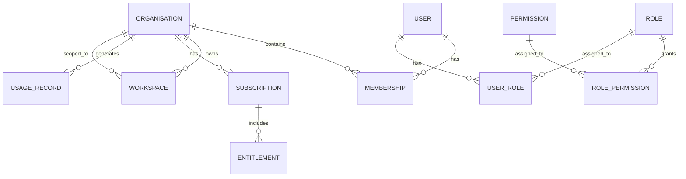

# Tenant and organisation data model

## 1. Purpose

This document defines the tenant and organisational structure underlying the platform. It governs identity, workspaces, membership, roles, permissions, product access and subscription state.

The model must support both formal organisations and individual users operating without a registered company. It must also carry tenant identity through every API call, job, and tool execution.

## 2. Core conceptual entities

### User

Purpose:
- represents a person accessing the platform.

Key attributes:
- user_id
- email
- display_name
- status
- created_at
- updated_at
- last_login_at
- locale
- mfa_enabled
- tenant_context_id

Relationships:
- belongs to one or many organisation memberships,
- may have one or many workspaces across organisations,
- may hold multiple role assignments,
- may own or trigger multiple executions and approvals.

Important note:
- a user is not automatically granted all product data access simply because they are a platform user.

### Organisation

Purpose:
- represents the tenant boundary for customers and internal groups.

Key attributes:
- organisation_id
- name
- legal_name
- tenant_slug
- status
- created_at
- owner_user_id
- billing_contact_id
- country
- type (company, sole trader, non-profit, internal, etc.)

Relationships:
- contains users via organisation_membership,
- owns one or many workspaces,
- owns subscriptions and entitlements,
- owns tenant-scoped records in both product domains.

### Workspace

Purpose:
- represents a logical operational area within an organisation.

Key attributes:
- workspace_id
- organisation_id
- name
- slug
- status
- created_at
- owner_user_id
- default_product_scope

Relationships:
- belongs to one organisation,
- can contain tenant-owned Business Partner records,
- can contain tenant-owned AI Hacker records,
- may be connected to specific product entitlements and permission sets.

### Organisation membership

Purpose:
- links a user to an organisation and captures their membership status.

Key attributes:
- membership_id
- organisation_id
- user_id
- role_assignment_id
- status
- invited_by
- invited_at
- accepted_at
- revoked_at

Relationships:
- member belongs to organisation,
- membership can be inactive or revoked,
- membership can be reused to derive effective permissions.

### Role

Purpose:
- defines a reusable permission profile for an organisation or workspace.

Key attributes:
- role_id
- organisation_id
- name
- scope (organisation, workspace, product)
- status
- created_at

Relationships:
- assigned to many users,
- mapped to permissions.

### Permission

Purpose:
- defines an action or capability that may be granted.

Key attributes:
- permission_id
- code
- description
- domain (platform, business_partner, ai_hacker)
- risk_level
- product_scope

Relationships:
- many-to-many with roles,
- many-to-many with product capabilities and tool definitions.

### Product entitlement

Purpose:
- defines which product features or capabilities an organisation can access.

Key attributes:
- entitlement_id
- organisation_id
- product_code
- plan_id
- granted_at
- expires_at
- status
- source

Relationships:
- linked to subscription,
- used by policy engine to decide product access,
- may limit feature availability.

### Subscription

Purpose:
- captures the commercial relationship between the tenant and the product offering.

Key attributes:
- subscription_id
- organisation_id
- product_code
- plan_id
- status
- start_date
- end_date
- auto_renew
- billing_reference

Relationships:
- many entitlements and usage summaries are derived from it,
- may be active, cancelled, or trial.

### Usage record

Purpose:
- stores usage metrics, quota consumption, and product-level events.

Key attributes:
- usage_id
- organisation_id
- product_code
- workspace_id (optional)
- metric_name
- metric_value
- period_start
- period_end
- source
- created_at

Relationships:
- linked to subscription and entitlement,
- aggregated into usage summaries.

## 3. Multi-tenant and individual-user considerations

The model must support:

- multiple users per organisation,
- multiple workspaces per organisation,
- varying access between products,
- different roles within the same organisation,
- product-specific permission assignment,
- individuals who are not registered as companies.

The platform should not assume every organisation is a registered company. A sole trader, freelancer, or independent operator may appear as a single-user organisation or as a small organisation with one principal user.

## 4. Organisation-level data ownership rules

Each organisation owns its own tenant-scoped data. That includes:

- workspaces,
- users with memberships,
- product records,
- subscriptions and entitlements,
- usage records,
- approvals and execution records tied to its tasks,
- integrations and related configuration.

## 5. Tenant identity propagation

Tenant identity must be carried through every request, job, and execution boundary.

This should be represented by:

- organisation_id on every tenant-owned record,
- workspace_id on workspace-scoped records,
- product_code or domain scope on product records,
- execution job metadata containing tenant and user context,
- job and queue payload validation before data access.

## 6. Role and permission model

The platform should use a layered model:

1. user has one or more organisation memberships,
2. organisation membership may grant a role,
3. role maps to permissions,
4. permissions are evaluated against product domain and workspace scope,
5. explicit tool and workflow access is checked at execution time.

This ensures that a user can be a member of an organisation without automatically having access to all product capabilities.

## 7. Relationship summary

## 8. Implementation guidance

The data model should enforce that:

- every access path has tenant context,
- every workspace is mapped to one organisation,
- organisation membership can be revoked without deleting the user record,
- a user may be active in multiple organisations with different roles,
- product access is always derived from entitlement and permission, not from UI state.

## 9. Open questions

The following design decisions still need review:

- whether workspace membership can be independent from organisation membership,
- whether product entitlements are organisation-wide or workspace-scoped,
- whether eligible commercial plans require one or many subscriptions per organisation,
- whether internal users and customer users share the same set of base tables or are separated by a user type flag.
