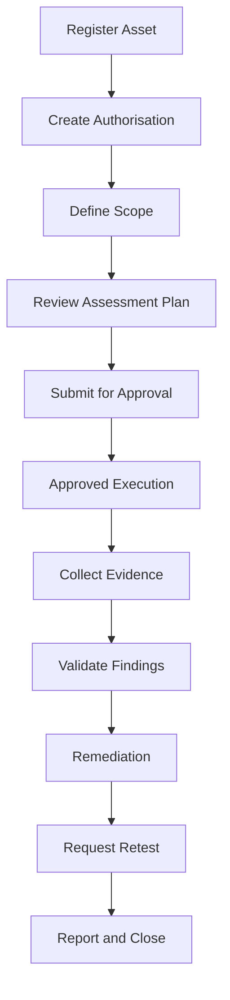

# AI Hacker user journeys

## 1. Journey 1: SaaS company creates an account and registers an application

### User goal
- Create organisation context and register an in-scope application.

### Starting point
- Initial platform sign-up and product selection.

### Screens visited
- Sign-up and account creation
- Workspace selection
- AI Hacker onboarding
- Asset registration
- Asset detail

### User actions
- create account,
- select AI Hacker,
- register target web app or API,
- add ownership and context metadata.

### System responses
- create product workspace,
- show asset readiness state,
- require authorisation before deeper assessment can proceed.

### Agent interactions
- summarise next onboarding steps and any missing items.

### Approval points
- none for registration; required for assessment execution.

### Failure and recovery
- if asset data is incomplete, the system flags missing required metadata.

### Successful completion condition
- asset is registered and visible in the security workspace.

## 2. Journey 2: customer supplies authorisation and defines the assessment scope

### User goal
- Confirm authorisation and define exactly what may be tested.

### Screens visited
- Authorisations and Scope
- Asset detail
- Scope inclusions and exclusions
- Test windows and restrictions

### User actions
- upload or record authorisation,
- define in-scope targets,
- add exclusions,
- set permitted techniques,
- define test windows.

### System responses
- validate the scope against the authorisation,
- flag invalid or missing items,
- store the active assessment plan.

### Agent interactions
- explain scope conditions and readiness.

### Approval points
- required before execution begins.

### Failure and recovery
- any mismatch between scope and authorisation blocks the assessment.

### Successful completion condition
- assessment is ready and approved to run within defined boundaries.

## 3. Journey 3: customer reviews the assessment plan

### User goal
- Understand the authorised assessment process before execution.

### Screens visited
- Assessment overview
- Assessment plan
- Scope validation panel
- Readiness checklist

### User actions
- review plan,
- verify asset and scope,
- confirm execution window,
- submit assessment for execution.

### System responses
- update status to ready,
- ensure policy and approval checks pass,
- prevent execution if policy is violated.

### Agent interactions
- summarise plan and highlight deployment risks or constraints.

### Approval points
- final execution approval required.

### Failure and recovery
- if anything is out of policy, user sees the exact issue and can revise the plan.

### Successful completion condition
- assessment is approved and marked as running inside approved boundaries.

## 4. Journey 4: assessment executes within approved boundaries

### User goal
- Run a controlled security assessment and review progress.

### Screens visited
- Assessment workspace
- Tool activity panel
- Evidence feed
- Findings list

### User actions
- start the assessment,
- monitor execution,
- review findings and evidence as they arrive.

### System responses
- check scope, authorisation, and tool permission,
- store evidence and findings,
- show assessment progress and any warnings.

### Agent interactions
- summarise findings and evidence with references.

### Approval points
- additional approval required if scope or technique changes.

### Failure and recovery
- if blocked or stopped, the user sees the reason and can choose next action.

### Successful completion condition
- assessment completes or pauses with a clear status and evidence record.

## 5. Journey 5: agent investigates and validates a finding

### User goal
- Confirm whether a candidate issue is a valid security finding.

### Screens visited
- Findings detail
- Validation panel
- Evidence panel
- Severity and impact summary

### User actions
- review candidate issue,
- assess evidence,
- validate severity or confidence,
- update status.

### System responses
- classify the finding,
- store evidence and reviewer status,
- require approval for final severity changes.

### Agent interactions
- explain evidence and classification rationale.

### Approval points
- severity and validation changes may require explicit approval.

### Failure and recovery
- insufficient evidence keeps the status pending or rejected.

### Successful completion condition
- finding is validated and accepted as a documented vulnerability or rejected with rationale.

## 6. Journey 6: customer reviews evidence and report

### User goal
- Understand the final assessment outcome and supporting proof.

### Screens visited
- Evidence centre
- Final report
- Remediation summary

### User actions
- review findings,
- inspect evidence,
- check report summary,
- decide next step.

### System responses
- provide report content and evidence references,
- maintain clear separation between findings and validated vulnerabilities.

### Agent interactions
- summarise the assessment and recommendations.

### Approval points
- final report delivery may require approval.

### Failure and recovery
- incomplete evidence prevents final report completion.

### Successful completion condition
- report is complete, validated, and ready for review.

## 7. Journey 7: customer remediates issue and requests retesting

### User goal
- Verify that a vulnerability has been addressed.

### Screens visited
- Remediation panel
- Retest request
- Verification results

### User actions
- review recommended fix,
- mark remediation as in progress,
- request retesting,
- review retest result.

### System responses
- validate that the retest remains within scope,
- track status and evidence.

### Agent interactions
- explain what changed and compare before and after evidence.

### Approval points
- retest and any scope change require approval.

### Failure and recovery
- if remediation is incomplete, the retest remains pending or failed.

### Successful completion condition
- evidence confirms the issue is resolved or remains open with clear rationale.

## 8. Mermaid flow diagram

## 9. Summary

The AI Hacker journey is designed to show that security work is controlled, evidence-backed, and approval-aware. The user experience must make the boundaries, risks, and current status explicit at every step.
