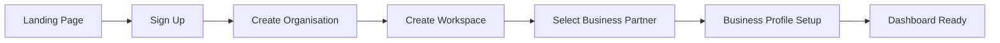

# Business Partner user journeys

## 1. Journey 1: new entrepreneur creates an account and sets up a business

### User goal
- Create an organisation and configure a first business profile.

### Starting point
- First-time visitor on the platform entry page.

### Screens visited
- Sign-up screen
- Organisation setup
- Workspace selection
- Business Partner onboarding
- My Business overview

### User actions
- create account,
- choose personal or business organisation,
- create workspace,
- select Business Partner product,
- enter basic business profile details.

### System responses
- create tenant and workspace,
- route to Business Partner onboarding,
- show empty-state dashboard with next steps.

### Agent interactions
- summarise profile and next steps,
- create suggested checklist for data import and business setup.

### Approval points
- none for initial setup.

### Failure and recovery
- if data is incomplete, dashboard tells user which fields are missing and guides completion.

### Successful completion condition
- business profile exists and dashboard has a first usable state.

### Mermaid flow

## 2. Journey 2: business owner imports financial information and views performance

### User goal
- Understand current business health from imported financial data.

### Screens visited
- Financial import screen
- Import status and data readiness
- Financial overview dashboard
- Revenue and expense summary

### User actions
- import revenue and expense data,
- review import quality,
- accept mapping,
- view summary performance by period.

### System responses
- validate imported records,
- flag mismatches,
- show clean and partial data states,
- calculate derived summary metrics.

### Agent interactions
- explain what the financial summary means,
- identify initial trends and risk areas.

### Approval points
- financial import may require review if it affects downstream actions.

### Failure and recovery
- if records are incomplete or mismatched, user is shown the exact issue and can fix the import.

### Successful completion condition
- financial summary and data quality state are visible and trusted.

## 3. Journey 3: business owner asks the agent to investigate declining profitability

### User goal
- Identify the cause of declining profitability and review the evidence.

### Screens visited
- Business Intelligence panel
- Analysis detail
- Financials and margin breakdown
- Evidence panel

### User actions
- ask a question such as “Why is profitability down?”
- review metrics and assumptions,
- inspect evidence and recommendations.

### System responses
- gather business context and financial data,
- produce findings, issues, opportunities, and evidence.

### Agent interactions
- summarise issue and explain why the conclusion was reached.

### Approval points
- none for read-only analysis.

### Failure and recovery
- if data is not sufficient, the system indicates missing data and provides next steps.

### Successful completion condition
- user sees a supported explanation with evidence and recommended next action.

## 4. Journey 4: agent identifies issue and proposes a business action

### User goal
- Create a proposed action with clear approval requirements.

### Screens visited
- Business Intelligence recommendation
- Proposed action detail
- Approval panel

### User actions
- review recommendation,
- accept or adjust action parameters,
- submit for approval.

### System responses
- store proposal with exact parameters,
- issue approval request,
- show pending approval status.

### Agent interactions
- present recommendation with reasoning and evidence.

### Approval points
- required before external or impactful execution.

### Failure and recovery
- if the action is rejected, user can revise or cancel the proposal.

### Successful completion condition
- the action is approved and ready for execution.

## 5. Journey 5: owner approves action and tracks execution

### User goal
- Complete and verify an approved action.

### Screens visited
- Approval detail
- Execution status page
- Activity feed
- Outcome detail

### User actions
- approve action,
- monitor status,
- review result.

### System responses
- allow execution,
- update task and action state,
- show progress and verification status.

### Agent interactions
- update execution progress and report findings.

### Approval points
- approval already granted.

### Failure and recovery
- failed execution is shown distinctly and can trigger a new action or retry path.

### Successful completion condition
- action reaches completed or verified state.

## 6. Journey 6: owner reviews outcome and evidence

### User goal
- Confirm the value of the action and understand the result.

### Screens visited
- Action outcome record
- Evidence panel
- Task history
- Business performance dashboard

### User actions
- review supporting evidence,
- accept verified outcome,
- record final business note or next action.

### System responses
- show final status, evidence references, and measurement against objectives.

### Agent interactions
- summarise result and business significance.

### Approval points
- none after verification unless another external action is triggered.

### Failure and recovery
- if verification is incomplete, status remains pending and next steps are shown.

### Successful completion condition
- result is verified and evidence is available for review.

## 7. Summary

The Business Partner journey is designed to feel practical and trustworthy. It supports meaningful business tasks while ensuring approvals and execution status are always visible and auditable.
