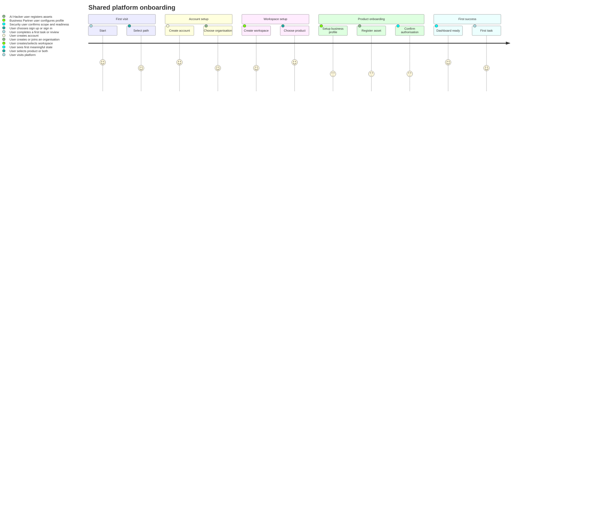

# Shared platform onboarding journey

## 1. Objective

This document defines the shared onboarding experience for the ZAR HORIZON AI @WORK platform. It covers the journey from first visit to a usable product workspace and makes a clear distinction between shared onboarding and product-specific setup.

## 2. Shared onboarding scope

The experience should support four common entry paths:

1. individual entrepreneur with no registered company,
2. existing registered business,
3. company with multiple users,
4. user invited into an existing organisation with one or both products already active.

## 3. Shared onboarding flow

### Step 1: first visit and entry

User lands on the platform entry page. The page presents:

- product overview,
- primary CTA to create account or sign in,
- information on shared platform and product offerings,
- clear statement that the user chooses an organisation and a product after sign-up.

System behaviour:

- if the user is new, redirect to sign-up or account creation,
- if returning, allow sign-in,
- if invited, allow organisation join flow.

### Step 2: authentication and account creation

User creates an account with:

- email,
- name,
- password or delegated auth method,
- optional company/legal entity information,
- user role preference (founder, manager, security lead, etc.).

The platform should not require a fully registered company for early access. For an individual entrepreneur, the system should support a personal workspace or a future organisation record that can later be upgraded.

### Step 3: organisation creation or membership selection

After sign-up, the user is asked whether they:

- create a new organisation,
- join an existing organisation,
- continue as a solo user.

The system should clearly distinguish:

- personal workspace,
- organisation workspace,
- shared team workspace.

### Step 4: workspace creation or selection

The user selects or creates a workspace.

Examples:

- personal business workspace,
- customer or security workspace,
- operations workspace.

The workspace should display:

- organisation name,
- workspace name,
- product access status,
- last active context.

### Step 5: product selection and entitlement check

The user chooses the product they need:

- AI Business Partner,
- AI Hacker,
- both.

The system should show:

- product availability,
- current entitlement status,
- onboarding requirements,
- whether a product is trial, active, or unavailable.

### Step 6: product-specific onboarding

This differs by product:

- Business Partner: setup business profile, data sources, objectives, and first tasks
- AI Hacker: register assets, authorisation, scope, and assessment readiness

The shared platform should remain the same; only the setup steps differ.

### Step 7: first successful outcome

The user reaches a first usable state:

- for Business Partner: first dashboard summary or imported financial view,
- for AI Hacker: first asset and authorisation status or assessment-ready state,
- for both products: a first activity or task created, and an obvious route to next action.

## 4. Product-specific onboarding differences

### Business Partner onboarding

A new business user must answer a limited set of questions:

- business type,
- operating region,
- business goals,
- what data needs to be imported,
- desired first analysis or action.

The system then shows a default dashboard with a helpful empty state.

### AI Hacker onboarding

A new security user must set up:

- customer or company context,
- asset registration,
- authorisation record,
- assessment scope and exclusions,
- risk and test-window visibility.

The system must not imply a target is testable simply because it is registered.

## 5. Mermaid user journey diagram

## 6. Distinct user paths

### Individual entrepreneur

- account created with personal profile,
- organisation created as a personal business entity,
- workspace created for business operations,
- product selected based on service or security need,
- simple onboarding checklist with low friction.

### Registered business

- organisation created with company information,
- workspace created for the operating unit,
- product access assigned by organisation or admin,
- onboarding includes business profile or security asset setup.

### Multi-user organisation

- admin creates organisation,
- invites additional members,
- assigns roles and workspace access,
- products are enabled per organisation,
- users join with explicit permissions.

### Organisation with both products

- same organisation has both Business Partner and AI Hacker product access,
- workspace remains product-aware,
- platform must maintain clear separation between product contexts,
- user sees only relevant nav and actions for the active product.

### Invited user

- user receives organisation invitation,
- joins selected workspace,
- inherits role and permission model,
- product access is determined by organisation entitlements.

## 7. UX quality goals

The shared onboarding experience should be:

- clear and low-friction,
- explicitly permission-aware,
- easy to exit and return to,
- honest about missing data or pending setup,
- fast to reach a first useful result.

The product-specific setup should never feel like a full product transformation before the user reaches a working state.
